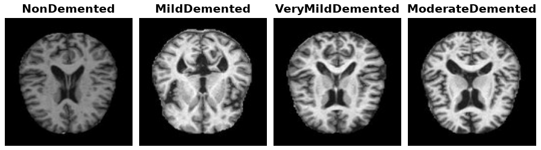

Alzheimer MRI
=============

.. raw:: html

   

   
   
   
   

Overview
--------

The Alzheimer MRI dataset has 6,400 grayscale brain MRI slices, each 128x128 pixels. Every slice is labeled with one of four stages of dementia: mild, moderate, non demented and very mild. It comes split into 5,120 training images and 1,280 test images.

The classes are very unbalanced. The moderate class has only 49 training images and 15 test images, while the non demented class has 2,566 and 634. Because of this, per class or balanced accuracy is more useful than plain accuracy.

Data Structure
--------------

Each example ``ds[i]`` is a dictionary with these keys:

.. list-table::
   :header-rows: 1
   :widths: 20 20 60

   * - Key
     - Type
     - Description
   * - ``image``
     - ``PIL.Image.Image``
     - 128x128 grayscale image
   * - ``label``
     - int
     - 0 MildDemented, 1 ModerateDemented, 2 NonDemented, 3 VeryMildDemented

Usage Example
-------------

.. code-block:: python

    from stable_datasets.images import AlzheimerMRI

    ds_train = AlzheimerMRI(split="train")
    ds_test = AlzheimerMRI(split="test")

    sample = ds_train[0]
    print(sample["label"])

References
----------

The data is hosted on Hugging Face at https://huggingface.co/datasets/Falah/Alzheimer_MRI under the Apache 2.0 license. The original source of the scans is not documented there.

Citation
--------

.. code-block:: bibtex

    @misc{falah2023alzheimermri,
      title={Alzheimer MRI Disease Classification Dataset},
      author={Falah},
      year={2023},
      howpublished={\url{https://huggingface.co/datasets/Falah/Alzheimer_MRI}}
    }
